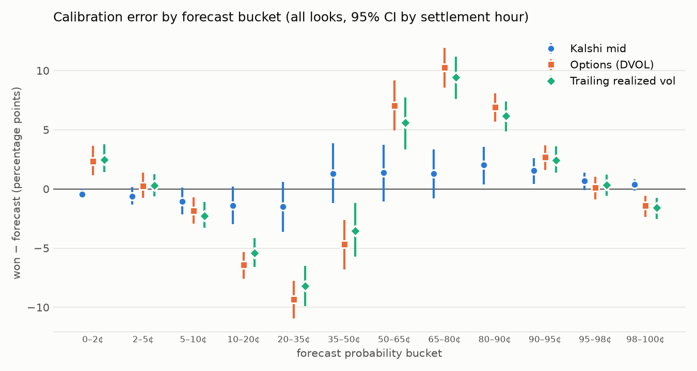
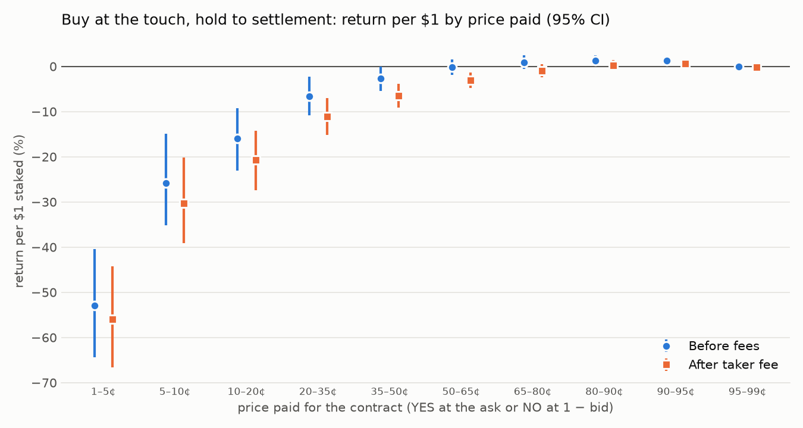

# Study A: are Kalshi's hourly BTC ladders mispriced against options?

**Data:** 1,377 settled KXBTCD hours closing between 2026-08-13 and 2026-10-11 (UTC). That is 78,050 (hour, look time, strike) observations, 44,515 of them with a two-sided quote. Every number here regenerates from one command, with no API key:

```bash
pip install "ladderbook[research]"
ladderbook study-a --start 2026-08-13 --end 2026-10-11      # ~30 min to download, then re-runs from the local cache
```

The full tables are in [`study-a/tables.md`](study-a/tables.md) and the raw numbers in [`study-a/results.json`](study-a/results.json).

## The question

Every hour Kalshi lists about 190 contracts of the form "BTC settles above $K", each paying $1 or $0. Deribit's options market prices the same risk. If Kalshi's prices disagreed with options in a systematic way, a market maker could quote around the options price and collect the difference.

So at 45, 30, 15 and 5 minutes before each close, three forecasts of "settles above K" are scored against what actually happened:

| forecast | what it is |
|---|---|
| **Kalshi mid** | halfway between the best YES bid and ask, where both exist |
| **Options** | the exact 60-second-average settlement model from `ladderbook.fair`, with Deribit's DVOL (its 30-day implied volatility index) as the volatility |
| **Realized** | the same model with the trailing 24-hour realized volatility of Coinbase BTC-USD |

Spot is Coinbase BTC-USD, corrected by the median gap between Coinbase and Kalshi's settlement index (CF Benchmarks' BRTI) over the previous 24 hours.

## Findings

### 1. Kalshi's mid is the best forecast at every horizon

The Brier score is the mean squared error of a probability: 0 is perfect, and always saying 50% scores 0.25. Lower is better.

| look | Kalshi | options (DVOL) | realized | Kalshi's edge over options |
|---|---|---|---|---|
| 45 min | 0.0948 | 0.1011 | 0.0998 | 0.0063 [0.0052, 0.0073] |
| 30 min | 0.0915 | 0.0985 | 0.0973 | 0.0070 [0.0060, 0.0082] |
| 15 min | 0.0854 | 0.0942 | 0.0922 | 0.0088 [0.0076, 0.0101] |
| 5 min | 0.0871 | 0.0971 | 0.0953 | 0.0101 [0.0084, 0.0118] |

Brackets are 95% intervals, bootstrapped by settlement hour. Every interval excludes zero, and log-loss gives the same ranking. The edge is largest 0.5–1 standard deviations from the money (0.0165) and vanishes beyond 2 standard deviations, where every forecast is close to 0 or 1.

(The 5-minute row is slightly worse than the 15-minute row because of composition, not lost skill. Strikes are kept within 4 standard deviations of spot, a band that narrows as time runs out, so the 5-minute rows are the hard, near-the-money ones.)

### 2. The options model fails on volatility, not direction



Each point shows how often contracts in a forecast bucket actually won, minus the forecast. On a calibrated forecast the points sit on zero.

- **Kalshi's mid is nearly calibrated:** within about 2 points in every bucket.
- **The options model has a tell-tale S shape.**
  - Its 20–35¢ forecasts won 9 points less often than predicted, and its 65–80¢ forecasts won 10 points more often. Its volatility is too high for the body of the distribution.
  - At the very tails it errs the other way: its 0–2¢ bucket (mean forecast 0.6%) won 2.9% of the time. One lognormal volatility can't fit BTC's calm-hour-plus-occasional-jump behaviour.

The volatility table shows why:

| look | Kalshi-implied | DVOL (30-day options) | trailing 24h realized | realized over the rest of the hour |
|---|---|---|---|---|
| 45 min | 28.0% | 36.9% | 35.5% | 26.6% |
| 30 min | 27.7% | 36.9% | 35.7% | 25.5% |
| 15 min | 26.6% | 37.0% | 36.4% | 24.4% |

(Medians, annualized.) Kalshi prices the hour at roughly the volatility that then occurs. The 30-day options volatility, and the 24-hour realized volatility, both run about 10 points higher. Variance is dominated by a few busy hours, so the typical hour is calmer than the average one. Kalshi's traders price the typical hour and still leave room for the jumps.

**So, relative to this options benchmark, Kalshi's ladders are not mispriced; if anything it's the other way round.** A market maker who quoted around a DVOL-based fair value would have been picked off on both sides of the money.

### 3. A strong favourite-longshot bias, but mostly at the touch



This test buys a contract at the best price offered and holds it to settlement. That means YES at the ask, or NO at 1 minus the YES bid.

| price paid | contracts | won | return before fees | after taker fee |
|---|---|---|---|---|
| 1–5¢ | 49,688 | 0.7% | −53.0% [−64.3, −40.4] | −56.0% |
| 5–10¢ | 8,933 | 5.1% | −25.8% [−35.2, −14.9] | −30.3% |
| 10–20¢ | 7,174 | 12.1% | −15.9% [−23.1, −9.2] | −20.6% |
| 20–35¢ | 6,488 | 25.0% | −6.6% [−10.8, −2.3] | −11.1% |
| 35–50¢ | 5,389 | 40.7% | −2.7% | −6.4% |
| 50–65¢ | 5,336 | 57.0% | −0.2% | −3.1% |
| 65–80¢ | 6,442 | 73.1% | +0.9% | −1.0% |
| 80–90¢ | 6,515 | 86.1% | +1.3% [+0.1, +2.5] | +0.2% |
| 90–95¢ | 6,036 | 93.4% | +1.2% [+0.3, +2.1] | +0.7% |
| 95–99¢ | 20,564 | 97.8% | −0.0% | −0.2% |

Cheap contracts lose heavily, and the losses shrink as the price rises; favourites at 80–95¢ earn about 1% before fees. This matches Bürgi, Deng & Whelan's finding across all of Kalshi ([*Makers and Takers*](https://cepr.org/publications/dp20631)): low-priced contracts win far less often than their price implies, high-priced ones earn small profits in some ranges, and prices become more accurate as the close approaches. Kalshi's Brier score here improves from 0.0948 at 45 minutes to 0.0854 at 15 minutes.

The calibration chart says how much of that is the spread. **Measured at the mid, the bias is small:** 5–10¢ forecasts won 6.1% of the time against a 7.2% mid. At 1–5¢ the 1¢ tick is most of the price, so paying the ask rather than the mid is most of the loss.

**For a market maker that's the point:** the taker's loss is the maker's spread. Resting offers on cheap contracts, i.e. selling the longshots, is where that money goes. Whether a maker actually gets filled there, without being picked off when BTC jumps, can't be answered from 1-minute candles. It needs the order-book recorder and the queue-position simulator.

## What this changes in ladderbook

1. **Don't anchor fair value on 30-day options volatility.** The fair-value engine should take its volatility from the nearest-expiry smile, which `ladderbook fair` already uses live and the recorder captures, or from Kalshi's own ladder. A follow-up study should test the nearest-expiry smile once recorded data exists.
2. **The strategy's edge is spread capture on the tails, with jump protection**, not a directional bet against Kalshi's prices. That is exactly what the Avellaneda–Stoikov quoting plus the reference-move cancel are for.
3. **The Coinbase-to-BRTI gap is small but real:** median +$2.63, interquartile range −$1.67 to +$6.85. That's enough to matter for at-the-money strikes; the live system should use BRTI directly, which needs the API key.

## Limits

- **One regime:** 59 days of one market environment (BTC near $83k at the end).
- **Volatility models:** DVOL is a 30-day volatility applied to a one-hour bet, with no smile; that mismatch is the point of finding 2, but it means "options" here is a deliberately simple benchmark, not Deribit's best short-dated price.
- **Spot proxy:** Coinbase stands in for BRTI before the settlement minute, corrected only by the trailing median gap.
- **Quote timing:** quotes are each minute's closing bid and ask. A mid is a forecast, not a price anyone could trade.
- **Daily events pooled:** the 5pm ET daily event (about 59 of the 1,377 hours, wider $250 strikes) is pooled with the hourly ones.
- **No look-ahead:** strikes are chosen, and spot corrected, using only what was known at each look time. `tests/test_study_a.py` checks that an hour's own settlement never reaches its forecast.
